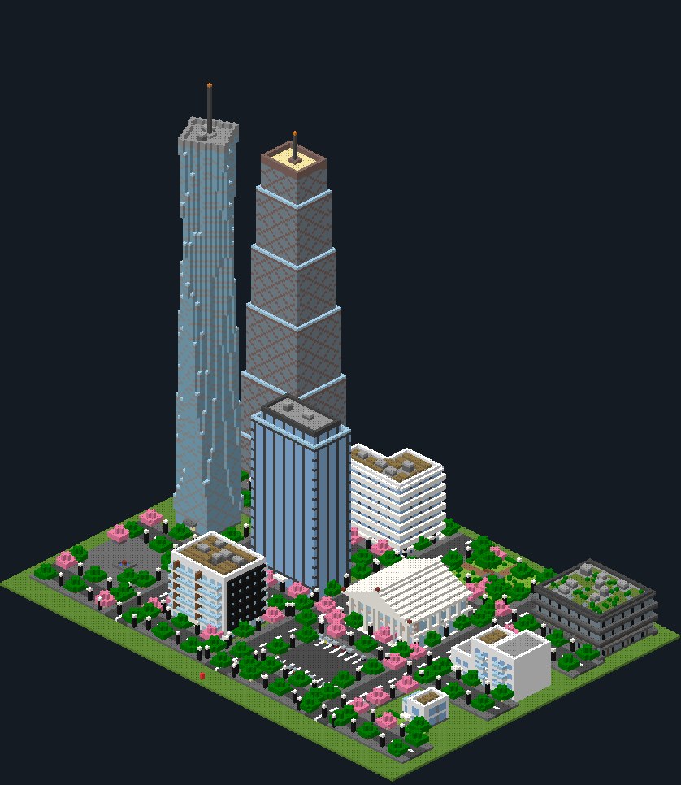
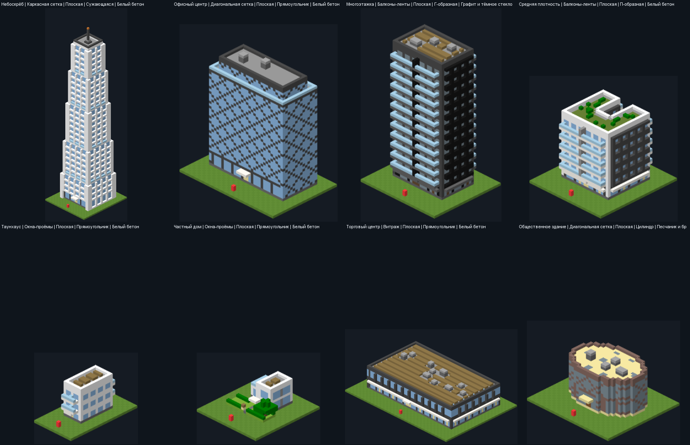
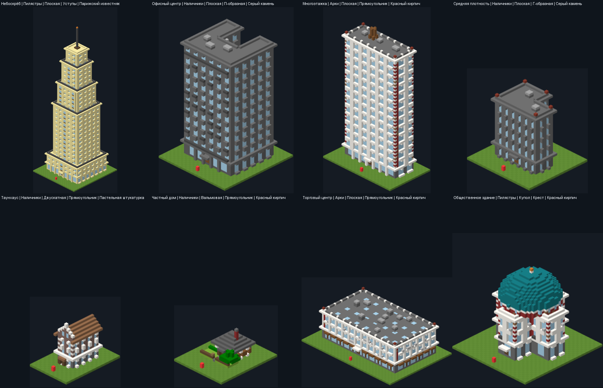
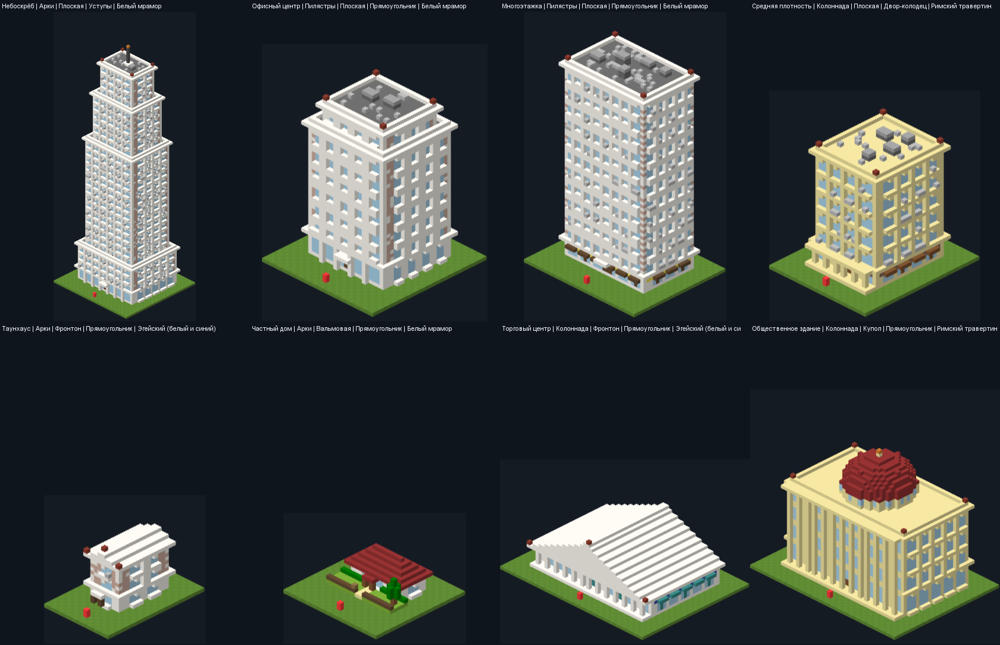
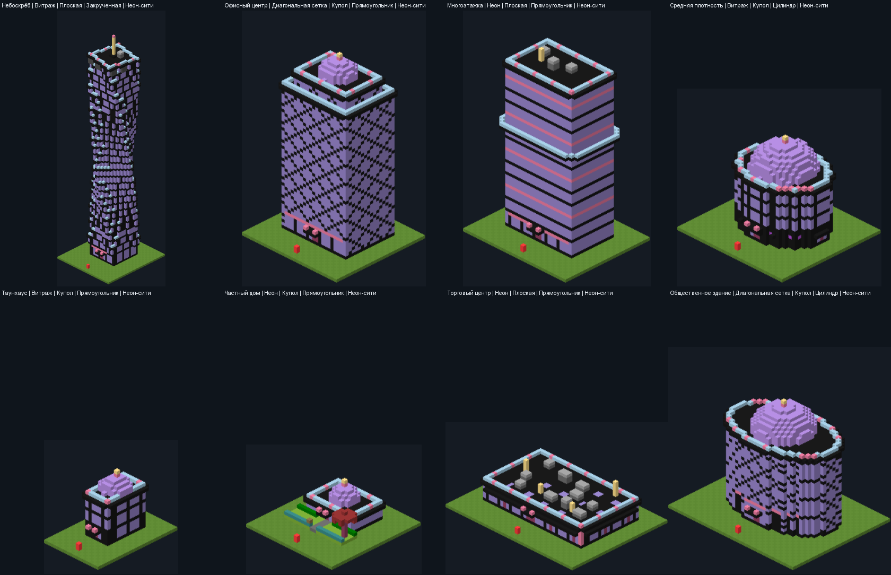
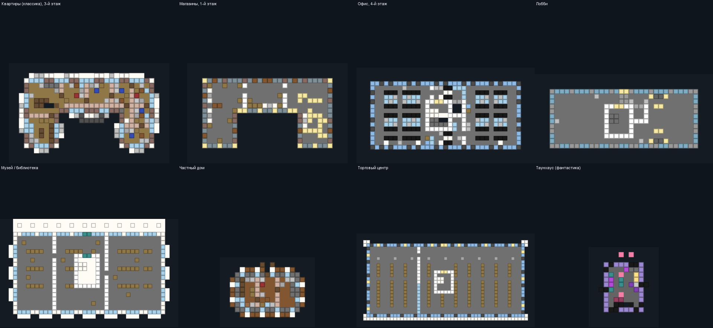
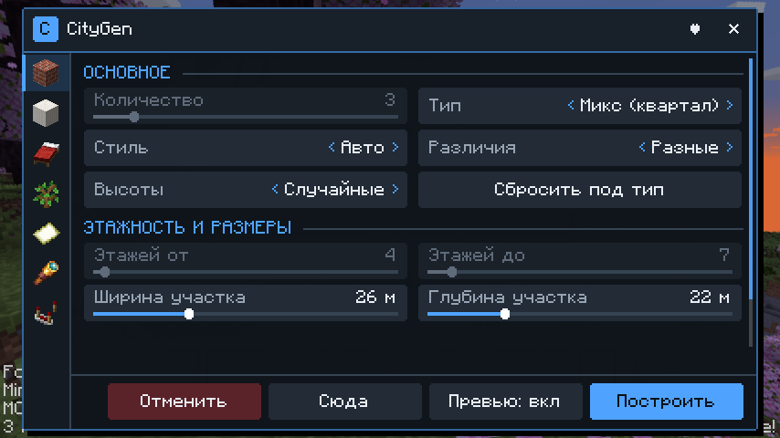
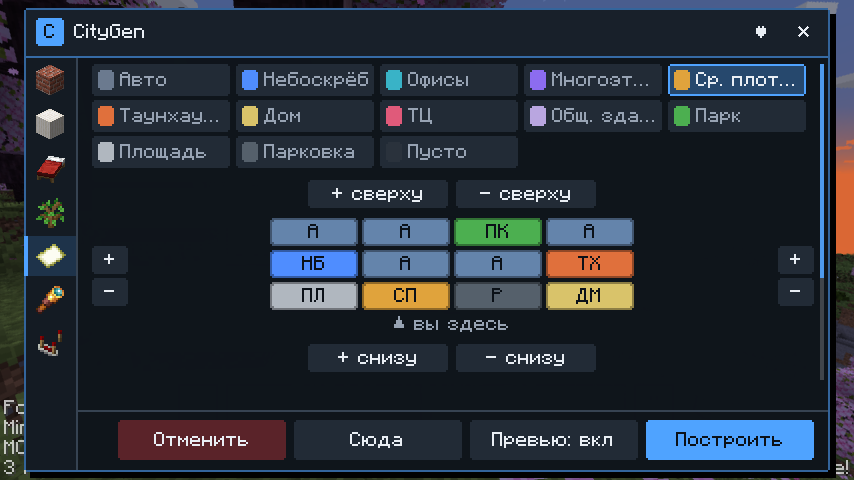
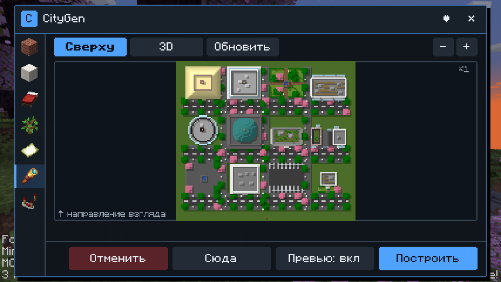
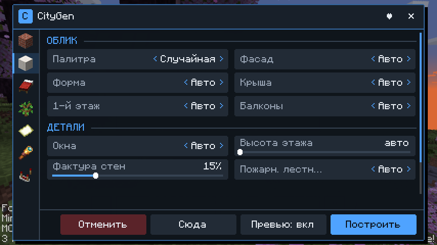

<div align="center">

# 🏙️ CityGen — генератор городов для Minecraft

**Целый квартал за один клик: небоскрёбы, многоэтажки, парижские дома, античные храмы и неоновые башни — с интерьерами, улицами и парками.**


**[⬇️ Скачать последнюю версию](../../releases/latest)** · [Возможности](#-возможности) · [Установка](#-установка) · [Как пользоваться](#-как-пользоваться) · [FAQ](#-частые-вопросы)



</div>

---

## ✨ Возможности

### 🏗️ 8 типов зданий
| Тип | Этажей | Что внутри и снаружи |
|---|---|---|
| **Небоскрёб** | 30–60 | Подиум с лобби, витраж или диагональная сетка, уступы, закрученные и цилиндрические башни, шпиль |
| **Офисный центр** | 8–20 | Ленточные окна, открытые офисы с рядами столов, переговорные со стеклянными стенами |
| **Многоэтажка** | 10–25 | Балконы и лоджии, квартиры, лестничная клетка и лифт |
| **Средняя плотность** | 4–8 | Магазины и кафе на первом этаже, мансарды, эркеры, дворы-колодцы |
| **Таунхаус** | 2–4 | Узкие дома вплотную, голландские ступенчатые фронтоны |
| **Частный дом** | 1–2 | Скатная или вальмовая крыша, крыльцо, палисадник с клумбами |
| **Торговый центр** | 1–3 | Витрины, супермаркет со стеллажами и кассами, зенитные фонари |
| **Общественное здание** | 2–4 | Музей или библиотека: колоннада, фронтон, купол |

### 🎨 4 архитектурных стиля и 18 палитр
| Современный | Культурный (европейский) |
|---|---|
|  |  |
| **Античный** | **Фантастический** |
|  |  |

- **Фасады:** витраж, каркасная сетка, ленточные окна, окна-проёмы, балконы-ленты, диагональная сетка, наличники, пилястры, арки, колоннада, неон.
- **Формы:** прямоугольник, Г- и П-образные, двор-колодец, крест, цилиндр, закрученная башня, сужающаяся, уступы.
- **Крыши:** плоская (с выходом, техникой, солнечными панелями или садом), мансарда, двускатная, вальмовая, фронтон, купол, шатёр.
- **Детали:** эркеры, балюстрады, ставни, кашпо с цветами, пожарные лестницы, «живая» фактура стен.

### 🛋️ Настоящие интерьеры


- **Квартиры:** гостиные с диваном и ТВ, спальни с кроватями и шкафами, кухни, санузлы.
- **Офисы:** открытые пространства и переговорные.
- **Первые этажи:** лобби с ресепшеном, кафе, пекарни, книжные, цветочные лавки, магазины одежды.
- **Общественные здания:** музеи с экспонатами и библиотеки со стеллажами.
- **Лестницы:** лестничные клетки с маршами и площадками, лифты с дверями и кнопками; в домах — лестница вдоль стены.
- **Двери:** из каждой комнаты можно выйти — генератор проверяет связность.
- **Свет:** ночью окна горят неравномерно, как в настоящем городе.

### 🗺️ Планировщик кварталов
Таблица участков как в Word: добавляйте ряды сверху/снизу и столбцы слева/справа (до 6×8).
Каждая клетка — здание нужного типа, **парк** (газон, дорожки, фонтан, скамейки), **площадь** (мощение, фонтан или памятник), **парковка** или пусто.
Между рядами и столбцами — дороги с разметкой, тротуары, фонари и деревья.

### 🌳 Аккуратная постройка
- **Расчистка:** весь квартал до самого верха; деревья удаляются **целиком**, без висящих крон.
- **Фундамент:** уходит до земли на склонах и над водой.
- **Без лагов:** стройка идёт порциями, прогресс показан над хотбаром.
- **Отмена:** **«Отменить»** возвращает местность как было (хранятся 5 последних построек).

---

## 🖥️ Редактор (клавиша **G**)
| Здания | Кварталы |
|---|---|
|  |  |
| **Вид сверху** | **Архитектура** |
|  |  |

- **Окно:** тёмное, его можно перетаскивать за заголовок; цвет акцента и прозрачность настраиваются.
- **Подсказки:** пояснение к любой настройке появляется внизу окна при наведении мыши.
- **Превью в мире:** цветные рамки будущих зданий; белая рамка — сторона входа.
- **Вид сверху:** мини-карта застройки — сверху или в 3D, с масштабом.

---

## 📦 Установка
1. Установите **Minecraft 1.20.1** с **Forge 47.x**. Подойдут официальный лаунчер, TLauncher, CurseForge, Prism.
2. Скачайте `CityGen-x.y.z-forge-1.20.1.jar` из **[Releases](../../releases/latest)**.
3. Положите файл в папку `mods`:
   - официальный лаунчер: `%APPDATA%\.minecraft\mods`;
   - TLauncher: `%APPDATA%\.tlauncher\legacy\Minecraft\game\mods`.
4. Запустите профиль Forge 1.20.1.

Совместим с OptiFine. Нужен в одиночной игре; на сервере мод должен стоять и на сервере, и у игроков.

## 🎮 Как пользоваться
1. Встаньте лицом туда, где нужен квартал, и нажмите **G**.
2. Выберите тип, стиль и количество зданий.
   - Для целого района включите схему **«Кварталы»** и раскрасьте таблицу.
3. Посмотрите рамки в мире или карту во вкладке **«Вид сверху»**.
   - Не нравится — **«Случайный сид»** даст новые варианты.
4. Нажмите **«Построить»**.

**Команды:** `/citygen undo` — отменить последнюю постройку, `/citygen cancel` — остановить стройку.
Строить могут операторы, игроки в творческом режиме и хозяин одиночного мира.

### Советы
- **Амстердам:** таунхаусы, промежуток **0**, «Разные».
- **Деловой центр:** «Микс», «Пик в центре», схема «Кварталы» с дорогами.
- **Париж:** средняя плотность и стиль «Культурный» — мансарды и кафе внизу.
- **Античный форум:** общественные здания, стиль «Античный», площадь в центре таблицы.
- **Киберпанк:** небоскрёбы, стиль «Фантастический», палитра «Неон-сити», ночь.

## ❓ Частые вопросы
**Здания появились в воздухе.** Начиная с 0.2.0 уровень ищется вниз от ног до земли — в прыжке и полёте тоже. Если рамки остались от старой точки, нажмите **«Сюда»**.

**Лагает при постройке.** Небоскрёбы с мебелью — это сотни тысяч блоков. Стройка разбита на порции, но для слабых ПК поставьте «Интерьер: Перекрытия» и меньше зданий.

**Можно ли отменить?** Да: кнопка «Отменить» или `/citygen undo`. Вернутся даже срубленные деревья.

## 🔧 Сборка из исходников
```bash
./gradlew build             # jar появится в build/libs
./gradlew runClient         # тестовый клиент
./gradlew runData           # самотест: картинки зданий в run-data/selftest
./gradlew runGameTestServer # постройка и отмена в настоящем мире
```
Нужен JDK 17. Если путь к профилю Windows содержит кириллицу, задайте временную папку латиницей:
`TMP=C:\Users\Public\tmp` и `JAVA_TOOL_OPTIONS=-Djdk.net.unixdomain.tmpdir=C:/Users/Public/tmp`.

## ❤️ Поддержать автора
**Так вы можете поддержать автора:** [обмен в Steam](https://steamcommunity.com/tradeoffer/new/?partner=1869951288&token=joiRehOd).
Ссылка есть и в самом моде — кнопка ♥ в редакторе.

## 📄 Лицензия
[MIT](LICENSE) © 2026 Atrem. Используйте, меняйте и делитесь — с указанием автора.

---
<sub>CityGen — фанатский мод, не связан с Mojang и Microsoft. Minecraft — товарный знак Mojang AB.</sub>
