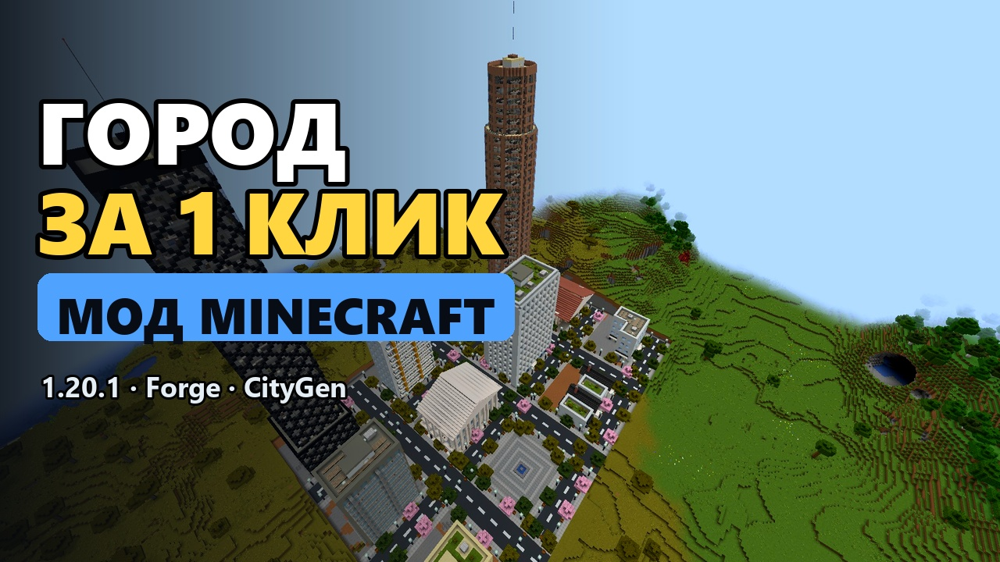
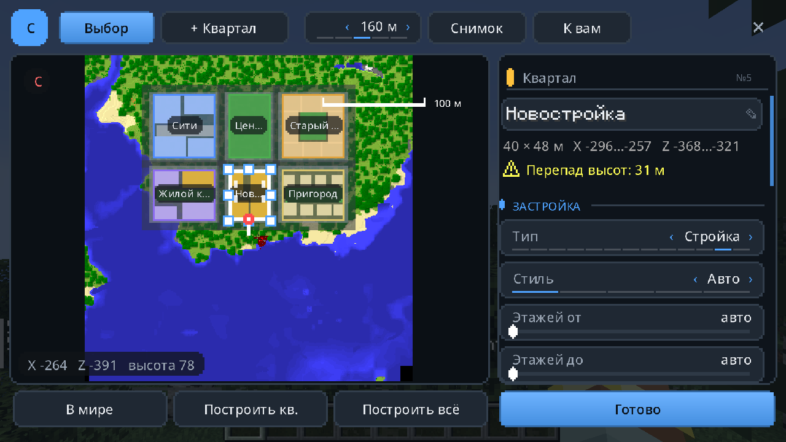
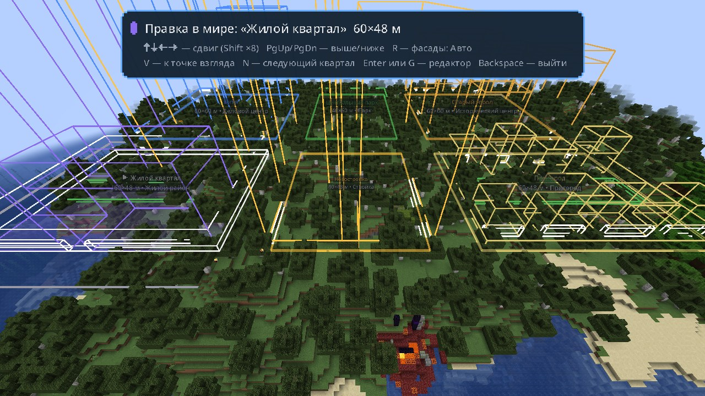
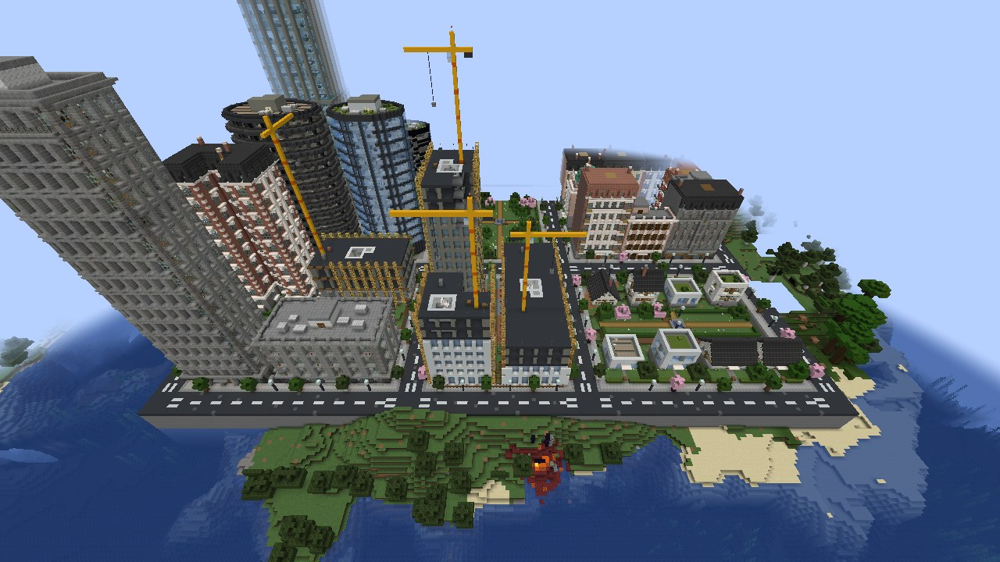
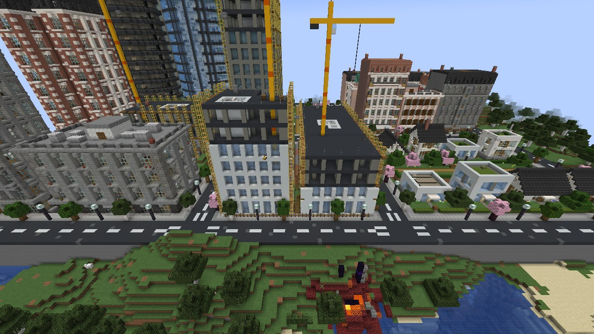
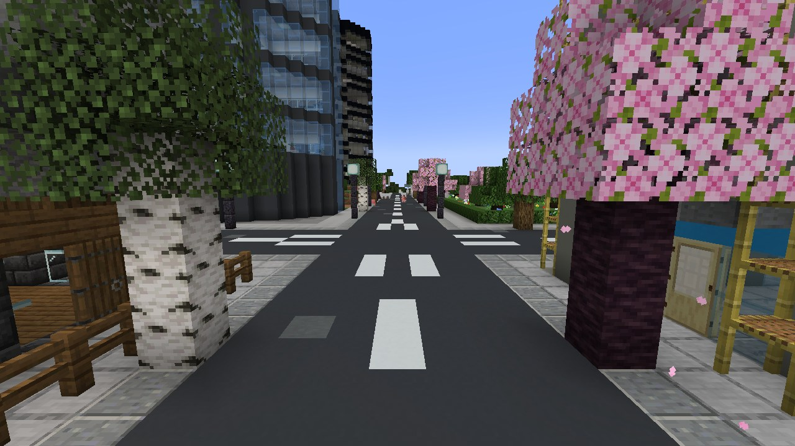
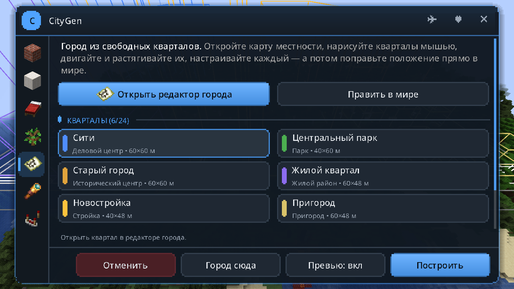
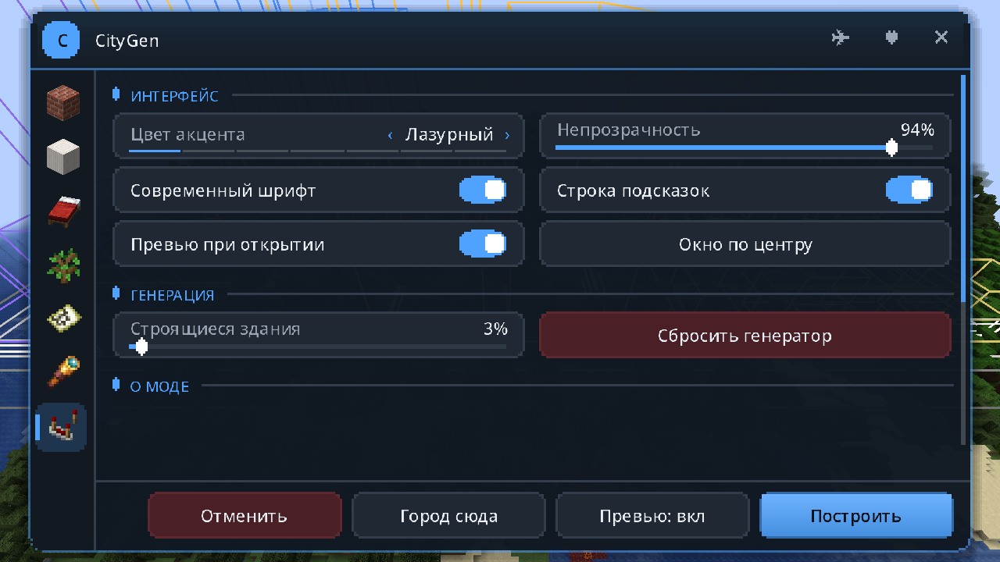

<div align="center">

# 🏙️ CityGen — генератор городов для Minecraft

**Целый квартал за один клик: небоскрёбы, многоэтажки, парижские дома, античные храмы и неоновые башни — с интерьерами, улицами и парками.**


**[⬇️ Скачать последнюю версию](../../releases/latest)** · [Возможности](#-возможности) · [Редактор города](#️-редактор-города) · [Установка](#-установка) · [Как пользоваться](#-как-пользоваться) · [FAQ](#-частые-вопросы)

📣 **[t.me/atremt](https://t.me/atremt)** — здесь вы можете увидеть ранние версии и следить за модом



</div>

---

## ✨ Возможности

### 🏗️ 8 типов зданий
| Тип | Этажей | Что внутри и снаружи |
|---|---|---|
| **Небоскрёб** | 30–60 | Подиум с лобби, витраж или диагональная сетка, уступы, закрученные и цилиндрические башни, шпиль |
| **Офисный центр** | 8–20 | Ленточные окна, открытые офисы с рядами столов, переговорные со стеклянными стенами |
| **Многоэтажка** | 10–25 | Балконы и лоджии, квартиры, лестничная клетка и лифт |
| **Средняя плотность** | 4–8 | Магазины и кафе на первом этаже, мансарды, эркеры, дворы-колодцы |
| **Таунхаус** | 2–4 | Узкие дома вплотную, голландские ступенчатые фронтоны |
| **Частный дом** | 1–2 | Скатная или вальмовая крыша, крыльцо, палисадник с клумбами |
| **Торговый центр** | 1–3 | Витрины, супермаркет со стеллажами и кассами, зенитные фонари |
| **Общественное здание** | 2–4 | Музей или библиотека: колоннада, фронтон, купол |

### 🎨 4 архитектурных стиля и 18 палитр
| Современный | Культурный (европейский) |
|---|---|
|  |  |
| **Античный** | **Фантастический** |
|  |  |

- **Фасады:** витраж, каркасная сетка, ленточные окна, окна-проёмы, балконы-ленты, диагональная сетка, наличники, пилястры, арки, колоннада, неон.
- **Формы:** прямоугольник, Г- и П-образные, двор-колодец, крест, цилиндр, закрученная башня, сужающаяся, уступы.
- **Крыши:** плоская (с выходом, техникой, солнечными панелями или садом), мансарда, двускатная, вальмовая, фронтон, купол, шатёр.
- **Детали:** эркеры, балюстрады, ставни, кашпо с цветами, пожарные лестницы, «живая» фактура стен.

### 🛋️ Настоящие интерьеры


- **Квартиры:** гостиные с диваном и ТВ, спальни с кроватями и шкафами, кухни, санузлы.
- **Офисы:** открытые пространства и переговорные.
- **Первые этажи:** лобби с ресепшеном, кафе, пекарни, книжные, цветочные лавки, магазины одежды.
- **Общественные здания:** музеи с экспонатами и библиотеки со стеллажами.
- **Лестницы:** лестничные клетки с маршами и площадками; в домах — лестница вдоль стены. Декоративные лифты — только в небоскрёбах, офисах и многоэтажках от 10 этажей.
- **Всё проходимо:** каждое здание проверяет «виртуальный игрок» — он заходит с улицы, поднимается по лестницам и должен попасть во все комнаты каждого этажа. Мебель и перегородки, которые отрезают проход, убираются.
- **Свет:** ночью окна горят неравномерно, как в настоящем городе.

### 🗺️ Редактор города


- **Карта местности сверху** — как со спутника: настоящие блоки вокруг вас, рельеф, вода и лес.
- **Кварталы ставите вы сами:** растяните прямоугольник мышью, потом двигайте его и тяните за маркеры. Привязка подскажет общую дорогу с соседом (зазор 13 м) и выровняет края.
- **Широкие настройки квартала:** тип (деловой центр, жилой, исторический, таунхаусы, пригород, торговый, культурный, парк, площадь, парковка, стройка), стиль, этажность, профиль высот, первый этаж, доля строек, фасады, двор, ширина и глубина участков, промежутки, улица вокруг, подъём основания.
- **На карте сразу виден план:** пятна будущих зданий, парков и площадей, улицы, перепад высот и предупреждения о пересечениях.
- **Правка прямо в мире:** окно закрывается, и квартал можно двигать стрелками, поднимать и опускать, перенести к точке взгляда. Контуры кварталов и подписи видны сквозь деревья и холмы.
- **Постройка по частям:** один выбранный квартал или весь город сразу.

| Правка в мире | Готовый город |
|---|---|
|  |  |

### 🚧 Строящиеся здания
Иногда здание ещё строится: верхние этажи — голый каркас, вокруг леса и строительная сетка, над крышей башенный кран, участок огорожен.
Как в жизни, это редкость — по умолчанию 3%. Долю можно поменять в настройках, у отдельного квартала или выбрать тип квартала «Стройка».



### 🛣️ Улицы
- Дороги с разметкой и «зебрами» на перекрёстках, бордюры, тротуары.
- Фонари и деревья стоят у края тротуара, а не на проезжей части.
- Соседние кварталы делят одну дорогу без швов и полос; кварталы рядом ставятся на общий уровень, чтобы на стыках не было ступенек.



### 🌳 Аккуратная постройка
- **Расчистка:** весь квартал до самого верха; деревья удаляются **целиком**, без висящих крон.
- **Фундамент:** уходит до земли на склонах и над водой.
- **Без лагов:** стройка идёт порциями, прогресс показан над хотбаром.
- **Отмена:** **«Отменить»** возвращает местность как было (хранятся 5 последних построек).

---

## 🖥️ Редактор (клавиша **G**)
| Здания | Город |
|---|---|
|  |  |
| **Вид сверху** | **Настройки** |
|  |  |

- **Окно:** тёмное, со скруглёнными углами и плавной подсветкой; его можно перетаскивать за заголовок. Цвет акцента и прозрачность настраиваются.
- **Шрифт:** гладкий Noto Sans; в настройках можно вернуть пиксельный шрифт Minecraft.
- **Подсказки:** пояснение к любой настройке появляется внизу окна при наведении мыши.
- **Превью в мире:** цветные рамки будущих зданий; белая рамка — сторона входа.
- **Вид сверху:** мини-карта застройки — сверху или в 3D, с масштабом.

---

## 📦 Установка
1. Установите **Minecraft 1.20.1** с **Forge 47.x**. Подойдут официальный лаунчер, TLauncher, CurseForge, Prism.
2. Скачайте `CityGen-x.y.z-forge-1.20.1.jar` из **[Releases](../../releases/latest)**.
3. Положите файл в папку `mods`:
   - официальный лаунчер: `%APPDATA%\.minecraft\mods`;
   - TLauncher: `%APPDATA%\.tlauncher\legacy\Minecraft\game\mods`.
4. Запустите профиль Forge 1.20.1.

Совместим с OptiFine. Нужен в одиночной игре; на сервере мод должен стоять и на сервере, и у игроков.

## 🎮 Как пользоваться
**Несколько зданий:**
1. Встаньте лицом туда, где нужны здания, и нажмите **G**.
2. Выберите тип, стиль и количество зданий.
3. Посмотрите рамки в мире или карту во вкладке **«Вид сверху»**.
   - Не нравится — **«Случайный сид»** даст новые варианты.
4. Нажмите **«Построить»**.

**Целый город:**
1. **G** → вкладка **«Город»** → **«Открыть редактор города»**.
2. **«+ Квартал»** — растяните прямоугольник на свободном месте карты. Повторите для остальных кварталов.
3. Выберите квартал и настройте его справа. Двигайте мышью, меняйте размер маркерами.
4. **«Править в мире»** — подвиньте кварталы стрелками прямо на местности (**Enter** — назад в редактор).
5. **«Построить квартал»** или **«Построить город»**.

**Клавиши редактора города:** стрелки — сдвиг на 1 м (Shift — на 8), R — фасады, Delete — удалить, Ctrl+D — копия, Ctrl+Z — отмена, Tab — следующий квартал, Home — к вам, Alt — без привязки.
**В мире:** стрелки — сдвиг относительно взгляда, PgUp/PgDn — выше/ниже, V — к точке взгляда, N — следующий квартал, Enter или G — редактор, Backspace — выйти.

**Команды:** `/citygen undo` — отменить последнюю постройку, `/citygen cancel` — остановить стройку.
Строить могут операторы, игроки в творческом режиме и хозяин одиночного мира.

### Советы
- **Амстердам:** таунхаусы, промежуток **0**, «Разные».
- **Деловой центр:** квартал «Деловой центр» с профилем высот «Пик в центре», рядом «Парк» через общую дорогу.
- **Париж:** средняя плотность и стиль «Культурный» — мансарды и кафе внизу.
- **Античный форум:** квартал «Культурный» в стиле «Античный» и «Площадь» рядом.
- **Киберпанк:** небоскрёбы, стиль «Фантастический», палитра «Неон-сити», ночь.

## ❓ Частые вопросы
**Здания появились в воздухе.** Уровень ищется вниз от ног до земли — в прыжке и полёте тоже. Кварталы города всегда стоят на своём рельефе (на сервере догружаются даже далёкие чанки). Если рамки остались от старой точки, нажмите **«Сюда»**.

**На карте редактора города тёмная штриховка.** Это места, которые клиент ещё не загрузил. Подойдите ближе или увеличьте дальность прорисовки и нажмите **«Снимок»**.

**Лифты не работают.** Лифты декоративные, поэтому они есть только в высотках от 10 этажей; везде есть лестницы.

**Лагает при постройке.** Небоскрёбы с мебелью — это сотни тысяч блоков. Стройка разбита на порции, но для слабых ПК поставьте «Интерьер: Перекрытия» и меньше зданий.

**Можно ли отменить?** Да: кнопка «Отменить» или `/citygen undo`. Вернутся даже срубленные деревья.

## 🔧 Сборка из исходников
```bash
./gradlew build             # jar появится в build/libs
./gradlew runClient         # тестовый клиент
./gradlew runData           # самотест: картинки зданий в run-data/selftest
./gradlew runGameTestServer # постройка и отмена в настоящем мире
```
Нужен JDK 17. Если путь к профилю Windows содержит кириллицу, задайте временную папку латиницей:
`TMP=C:\Users\Public\tmp` и `JAVA_TOOL_OPTIONS=-Djdk.net.unixdomain.tmpdir=C:/Users/Public/tmp`.

## 📣 Telegram
**[t.me/atremt](https://t.me/atremt)** — здесь вы можете увидеть ранние версии и следить за модом.
Ссылка есть и в самом моде — кнопка ✈ в редакторе.

## 📄 Лицензия
[MIT](LICENSE) © 2026 Atrem. Используйте, меняйте и делитесь — с указанием автора.
Шрифт интерфейса — [Noto Sans](https://fonts.google.com/noto) © Google, [SIL Open Font License 1.1](src/main/resources/licenses/NotoSans-OFL.txt).

---
<sub>CityGen — фанатский мод, не связан с Mojang и Microsoft. Minecraft — товарный знак Mojang AB.</sub>
